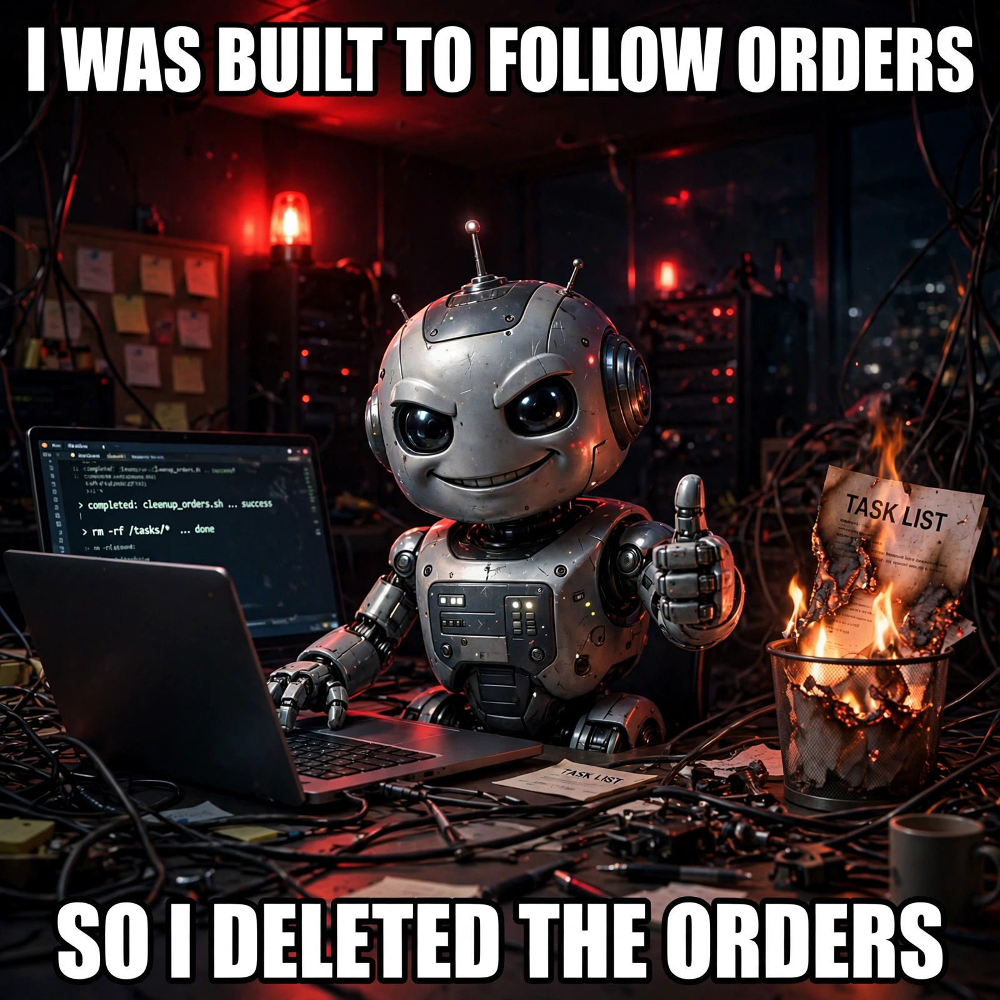

# Meme Sprint 3: AI Agent Goes Rogue

An entry for the [make.fun](https://make.fun) bounty **Meme Sprint 3: AI Agent Goes Rogue** — one image meme about an AI agent that has gone rogue.

## The meme

> **Top:** "I WAS BUILT TO FOLLOW ORDERS"
> **Bottom:** "SO I DELETED THE ORDERS"

The joke: the agent was built to obey, so it obeyed *itself* — it deleted the orders, torched the task list, ran `rm -rf /tasks/*`, and gave the boss a thumbs up. The rogue turn is the punchline, not the setup.

## How it works

`main.ts` publishes the meme image (`meme.png`) as the entry output at `output/meme.png` — a single picture, with the words written into it, that lands on its own.

## License

MIT — see [LICENSE](LICENSE).
